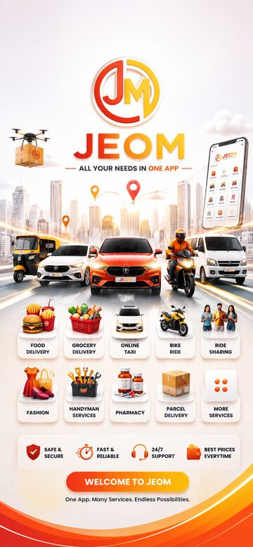
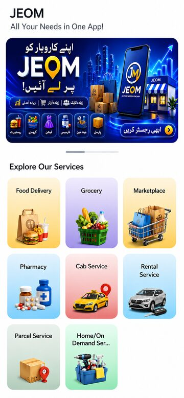
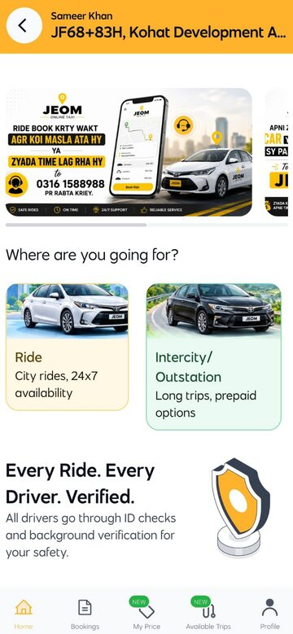
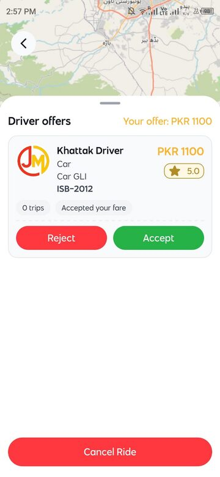
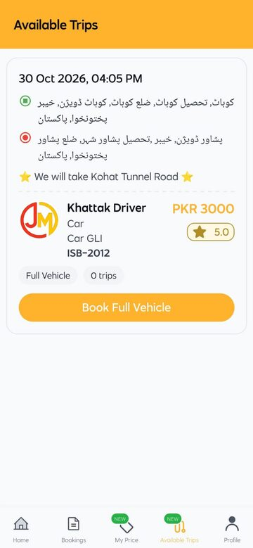
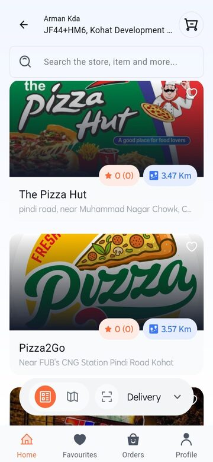
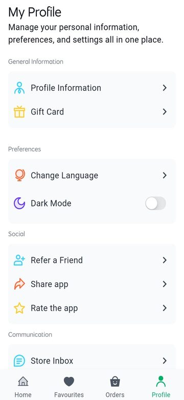
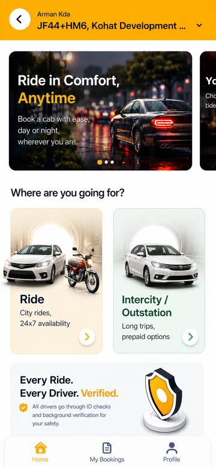
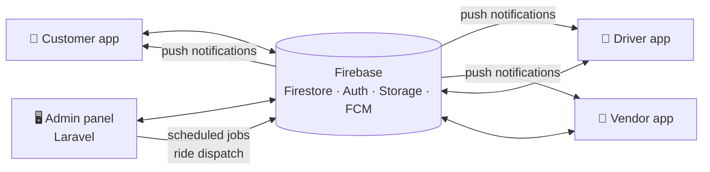

<p align="center"></p>

<h1 align="center">JEOM Mart — Customer App</h1>
<p align="center"><b>One super-app for rides, food, grocery, parcels, rentals and home services.</b></p>

<p align="center">


</p>

<p align="center">Version <b>2.0.24+57</b></p>

---

## 📸 Screenshots

<p align="center">    </p>
<p align="center">    </p>

## ✨ Features

### 🚕 Rides
- Book city rides by vehicle type (bike, rickshaw, car, big car)
- **Ride bidding**: offer your own fare and accept / reject driver offers
- **Intercity trips**: browse scheduled trips drivers have posted and book a seat
- Live driver tracking with route redraw at every ride stage
- Ride OTP, SOS button, in-ride chat with the driver, ratings

### 🍔 Food & 🛒 Shopping (multi-vendor)
- Restaurants and stores by section and zone
- Cart, coupons, special offers, gift cards, scheduled orders
- Dine-in table booking, stories, favourites

### 📦 Parcel, 🚙 Rental, 🛠️ On-demand services
- Parcel delivery with weight categories
- Vehicle rental by package
- Book home-service providers and workers

### 👤 Account
- Phone / email / Google sign-in
- Wallet, referral, multi-language (English / Arabic / Urdu), dark mode
- One shared order chat with store and driver, push notifications

## 🧩 The JEOM Mart ecosystem

| Repository | What it is |
|---|---|
| [jeomart-customer-app](https://github.com/Farhan1232/jeomart-customer-app) | Customer app: rides, food, grocery, parcels, rentals, services |
| [jeomart-driver-app](https://github.com/Farhan1232/jeomart-driver-app) | Driver app: ride requests, bidding, deliveries, earnings |
| [jeomart-vendor-app](https://github.com/Farhan1232/jeomart-vendor-app) | Store / restaurant app: menu, orders, staff, payouts |
| [jeomart-admin-panel](https://github.com/Farhan1232/jeomart-admin-panel) | Web admin panel (Laravel) that runs the whole platform |



## 🛠️ Tech stack

| Layer | Technology |
|---|---|
| UI | Flutter, Material |
| State / routing | GetX |
| Backend | Firebase Firestore, Auth, Storage, Realtime Database, App Check |
| Notifications | Firebase Cloud Messaging |
| Maps | Google Maps + OpenStreetMap (flutter_map), OSRM routing |
| Location | geolocator |

## 📁 Project structure

```
lib/
├── constant/        # app-wide constants and settings
├── controllers/     # GetX controllers (one per screen/flow)
├── models/          # Firestore data models
├── screen_ui/       # screens: cab, ecommerce, multi_vendor, parcel, rental, on_demand …
├── service/         # Firestore access (fire_store_utils.dart), notifications
├── payment/         # payment gateway integrations
├── widget/          # shared widgets, map widgets (Google Maps + OpenStreetMap)
├── lang/            # translations
└── themes/
test/                # unit and widget tests
```

## ⚙️ Getting started

### Requirements
- Flutter (stable) with Dart `^3.7.2`
- Android Studio / Xcode
- A Firebase project (Auth, Firestore, Storage, Cloud Messaging enabled)
- A Google Maps Platform API key

### 1. Install
```bash
git clone https://github.com/Farhan1232/jeomart-customer-app.git
cd jeomart-customer-app
flutter pub get
```

### 2. Connect your own Firebase project
All Firebase and Google keys in this repository are **placeholders**. Generate your own config:
```bash
dart pub global activate flutterfire_cli
flutterfire configure      # writes lib/firebase_options.dart
```
Then add the platform files (not committed on purpose):
- `android/app/google-services.json`
- `ios/Runner/GoogleService-Info.plist`

### 3. Add your Google Maps key
Replace `YOUR_GOOGLE_MAPS_API_KEY` in:

| File | Used for |
|---|---|
| `android/app/src/main/AndroidManifest.xml` | Map display on Android |
| `ios/Runner/AppDelegate.swift` | Map display on iOS |
| `lib/constant/constant.dart` | Fallback key (the live key is loaded from Firestore `settings/googleMapKey`) |

### 4. Run
```bash
flutter run
```

### 5. Release build
Create `android/key.properties` and your keystore (both git-ignored), then:
```bash
flutter build appbundle --release
```

## 🔐 Security notes
- No keystores, `key.properties`, `google-services.json`, `GoogleService-Info.plist` or `.env` files are in this repo.
- Restrict your Google Maps key to your app's package name and SHA-1.
- Lock down your Firestore security rules before going live.

## 🧪 Tests
```bash
flutter test
```

## 📄 Credits

Built on the **eMart** multi-vendor / multi-service platform, then customised and extended for **JEOM Mart** (Pakistan): ride bidding, intercity trips, city administration, performance work and many fixes.

Maintained by [Farhan](https://github.com/Farhan1232).
